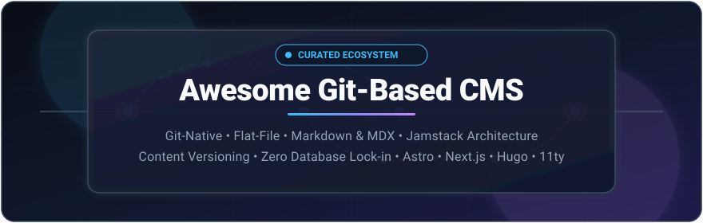

  

# Awesome Git-Based CMS    

> A curated directory and ecosystem guide of the best **Git-Based CMS**, **Flat-File CMS**, and **Headless Content Management Systems** for Jamstack, static site generators (Astro, Next.js, Hugo, Jekyll, Eleventy, Nuxt, SvelteKit), and GitOps documentation workflows.

A **Git-based CMS** provides a user-friendly editorial dashboard on top of a Git repository (GitHub, GitLab, or Bitbucket). Content changes are saved directly as Markdown, MDX, YAML, or JSON commits into your source code repository—enabling non-technical writers and editors to manage content seamlessly while developers preserve full branch control, code reviews, audit trails, rollbacks, and zero database lock-in.

---

## Table of Contents

- [Why Git-Based CMS?](#why-git-based-cms)
- [Sector Overview & Market Dynamics](#sector-overview--market-dynamics)
- [SaaS & Hosted Platforms Comparison](#saas--hosted-platforms-comparison)
- [Open-Source GitHub Projects](#open-source-github-projects)
- [Architecture Guide: Git-Based vs. API-First](#architecture-guide-git-based-vs-api-first)
- [How to Choose the Right CMS](#how-to-choose-the-right-cms)
- [How to Contribute](#how-to-contribute)
- [License & Disclaimer](#license--disclaimer)

---

## Why Git-Based CMS?

| Capability | Traditional Database CMS | API-First Headless CMS | Git-Based CMS |
| :--- | :--- | :--- | :--- |
| **Content Storage** | Relational / SQL Database | Vendor Cloud Database | Your Git Repository (Markdown, JSON, YAML) |
| **Version Control & Rollbacks** | Database backups / revisions | Vendor version history | Native Git commits, tags, and git log |
| **Branching & Staging** | Complex staging databases | Environments (paid add-on) | Git branches & Pull Request preview builds |
| **Vendor Lock-In** | High | High (Proprietary APIs) | **Zero** (You own every content file) |
| **Hosting Costs** | Ongoing DB servers | Usage-based SaaS fees | Static hosting (Vercel, Netlify, GitHub Pages, Cloudflare) |
| **Developer Experience** | Custom templates & plugins | REST / GraphQL SDKs | Native files in repo alongside codebase |

---

## Sector Overview & Market Dynamics

The global Headless and Git-Based CMS market is estimated between **$1.2 Billion and $3.9 Billion**, expanding at a rapid compound annual growth rate (CAGR) of **~18% to 22%** toward a projected **$6B to $26B** by the mid-2030s.

The sector is **highly fragmented** rather than concentrated (*winner-take-all*), characterized by diverse architectural philosophies:
- **API-First Enterprise SaaS**: Platforms such as Contentful, Sanity, and Storyblok capture high-value enterprise omnichannel workloads.
- **Git-Native & Jamstack CMS**: Solutions like CloudCannon, TinaCMS, Decap CMS, and Keystatic lead developer adoption for static sites, documentation, and decoupled Jamstack web apps.
- **Open-Source Self-Hosted**: Tools like Strapi, Decap, and Sveltia appeal to security-sensitive teams refusing database vendor lock-in.

Industry surveys show that most enterprise engineering teams operate **two or more distinct CMS solutions concurrently** to serve marketing, technical writing, and microservice needs.

---

## SaaS & Hosted Platforms Comparison

Curated list of commercial and managed SaaS platforms supporting Git-native workflows or closely associated in the modern headless content management ecosystem, sorted descending by **Company Scale (Valuation / Revenue)**:

| Platform | Company Scale (Valuation / Revenue) | Architecture / Type | Pricing (Starting Tier) | Free Tier Limits / Free Trial Details |
| :--- | :--- | :--- | :--- | :--- |
| **[Contentful](https://www.contentful.com/)** | **$3.0B Valuation** (~$200M ARR / $350M+ funding) | API-first Headless (Cloud Database) | Starts at **$300/mo** (Lite / Basic Plan) | **Free forever plan**: Up to 10 users, 2 roles, 2 locales, 1 Starter Space, 100K API calls/month, and 50 GB CDN bandwidth/month |
| **[Sanity](https://www.sanity.io/)** | **~$550M Valuation** (~$40M ARR / $170M+ funding) | API-first Headless (Content Lake) | Starts at **$15/seat/mo** (Growth Plan) | **Free forever plan**: Up to 20 user seats (unlimited free viewers), 2 public datasets, 10,000 documents, 1M API requests/month, and 5M CDN requests/month |
| **[Storyblok](https://www.storyblok.com/)** | **~$450M Valuation** (~$80M ARR / $138M funding) | API-first Headless (Component-based) | Starts at **$90.75/mo** (billed annually) or **$99/mo** (Growth Plan) | **Free forever plan**: 1 user seat (expandable to 2), 1 space, 100 GB traffic/month, 1M API requests/month, 2 locales, and Visual Editor access |
| **[Strapi Cloud](https://strapi.io/)** | **~$250M Valuation** (~$10M ARR / $47M funding) | Hosted Headless CMS (PostgreSQL / API) | Starts at **$29/mo** (billed annually) or **$35/mo** (Starter Plan) | **Free forever (Self-hosted Community Edition)**: Unlimited content and users when self-hosting; Strapi Cloud has no cloud free plan or cloud trial, but includes a **30-day trial** for self-hosted Enterprise features |
| **[Prismic](https://prismic.io/)** | **~$100M Valuation** (~$15M ARR / $19.4M funding) | API-first Headless (Slice Machine) | Starts at **$10/mo** (Starter Plan for up to 3 users) | **Free forever plan**: 1 user seat, 2 locales, 100 GB CDN bandwidth/month, unlimited API requests, and Slice Machine visual editor access |
| **[CloudCannon](https://cloudcannon.com/)** | **~$15M Valuation** (~$2.5M ARR / $518K funding) | Git-based CMS (Direct Git commits) | Starts at **$45/mo** (billed annually) or **$49/mo** (Standard Plan) | **21-day free trial**: Full Standard Plan features, unlimited test sites on `.cloudvent.net` domains, no credit card required |
| **[TinaCMS (TinaCloud)](https://tina.io/)** | **~$10M Valuation** (SSW Group backing / Open-core) | Git-based CMS (GraphQL + Git sync) | Starts at **$29/mo** (Team Plan) | **Free forever plan**: Up to 2 users, 500 assets/month, real-time visual editing, and Git sync |

---

## Open-Source GitHub Projects

Curated list of active, open-source Git-based content management systems, sorted descending by GitHub stargazers count:

- **[Decap CMS (formerly Netlify CMS)](https://github.com/decaporg/decap-cms)**   
  The established open-source Git-based CMS standard. A single-page React app that provides a clean content authoring UI on top of GitHub, GitLab, or Bitbucket. Commits Markdown, JSON, and YAML directly to your repository. **Drop-in installation**: add an HTML entry point and YAML config to your static site's `/admin` route. Works with any static site generator (Hugo, Jekyll, Eleventy, Gatsby, Astro). MIT licensed.

- **[TinaCMS](https://github.com/tinacms/tinacms)**   
  Open-source Git-backed headless CMS delivering **in-context visual live editing**—authors edit text and media directly on the rendered page. Powered by a TypeScript schema-as-code configuration and a GraphQL content layer. Ideal for modern Next.js and React stacks. Apache 2.0 licensed.

- **[Statamic Core](https://github.com/statamic/cms)**   
  A powerful flat-file, Git-friendly CMS powered by PHP and Laravel. Content is saved as YAML front-matter files directly in your repository without requiring a relational database. Features a robust control panel, live preview, version control integration, and asset management.

- **[Prose](https://github.com/prose/prose)**   
  A classic, lightweight web-based content editor specifically designed for managing Jekyll websites and Markdown documents hosted directly on GitHub. Connects via GitHub OAuth to provide a clean writing environment with live Markdown previews and syntax highlighting.

- **[Pages CMS](https://github.com/pages-cms/pages-cms)**   
  A fast, GitHub-native Git-based CMS that requires zero build step or server setup. Offers a clean, minimal interface designed for personal blogs, documentation, and small business sites. Commits changes directly to your repository branches. MIT licensed.

- **[Outstatic](https://github.com/avitorio/outstatic)**   
  A Git-based headless CMS tailored for Next.js (App Router and Pages Router). Provides a full-featured dashboard, rich text editor, custom schema creation, and automatic commits to GitHub repositories without external databases or third-party cloud services. MIT licensed.

- **[Sveltia CMS](https://github.com/sveltia/sveltia-cms)**   
  A modern, lightweight successor to Decap/Netlify CMS rebuilt from scratch in Svelte. Maintains **100% configuration compatibility** with Decap's `config.yml` while offering faster initial load times, built-in internationalization (i18n), and an improved mobile-friendly editing UX. Works statically with Astro, Hugo, Eleventy, and Vite. MIT licensed.

- **[Jekyll Admin](https://github.com/jekyll/jekyll-admin)**   
  The official in-browser graphical interface plugin for Jekyll sites. Runs locally or in deployment environments to let content creators author posts, manage pages, upload media files, and update front matter with automated Git tracking. MIT licensed.

- **[Keystatic](https://github.com/Thinkmill/keystatic)**   
  An open-source, Git-based content management framework by Thinkmill built for Next.js, Astro, and Remix. Allows structured content definition via TypeScript schemas with local filesystem development mode and cloud/GitHub sync for production publishing. MIT licensed.

- **[Static CMS](https://github.com/StaticJsCMS/static-cms)**   
  A community-maintained, modernized fork of Netlify CMS. Offers a drop-in single-page application admin interface with TypeScript support, enhanced collection configurations, and native GitHub/GitLab/Bitbucket authentication. MIT licensed.

---

## Architecture Guide: Git-Based vs. API-First

Understanding the architectural distinction helps ensure you choose the right system for your requirements:

| Dimension | Git-Based CMS | API-First Headless CMS |
| :--- | :--- | :--- |
| **Where Content Lives** | Markdown / MDX / YAML / JSON files in Git repository | Proprietary database / hosted cloud storage |
| **Publishing Mechanism** | `git commit` & `git push` triggering static CI/CD builds | Webhooks triggering static builds or live REST/GraphQL fetches |
| **Authentication** | OAuth via GitHub, GitLab, Bitbucket | Vendor-managed IAM, SSO, or email/password |
| **Offline Editing** | Native (edit `.md` files in VS Code / Obsidian anytime) | Dependent on vendor internet connectivity |
| **Typical Generators** | Astro, Hugo, Next.js, Eleventy, Jekyll, Gatsby, VitePress | Next.js, Nuxt, Remix, Mobile Apps (iOS/Android), IoT |
| **Editorial Collaboration** | Branch-based pull requests and staged previews | Custom draft workflows and scheduled publishing in dashboard |

---

## How to Choose the Right CMS

- **For Greenfield SSG Sites (Astro, Hugo, 11ty):** Choose **[Sveltia CMS](https://github.com/sveltia/sveltia-cms)** for high performance and full Decap YAML compatibility, or **[Keystatic](https://github.com/Thinkmill/keystatic)** for TypeScript schema ergonomics.
- **For In-Context Visual Page Editing:** Choose **[TinaCMS](https://github.com/tinacms/tinacms)** if you want live click-to-edit capabilities directly on your React/Next.js frontend.
- **For Non-Technical Client Work on Static Sites:** Choose **[CloudCannon](https://cloudcannon.com/)** for a polished client-facing visual editor with hosting and forms.
- **For Zero-Setup Personal Blogs:** Choose **[Pages CMS](https://github.com/pages-cms/pages-cms)** for quick GitHub-connected editing with no build step.
- **For Next.js-Dedicated Workflows:** Choose **[Outstatic](https://github.com/avitorio/outstatic)** or **[Keystatic](https://github.com/Thinkmill/keystatic)**.
- **For Complex Omnichannel Content Distribution:** Choose an API-first platform like **[Sanity](https://www.sanity.io/)** or **[Contentful](https://www.contentful.com/)**.

---

## How to Contribute

Contributions are welcome! To add or update an entry:

1. Fork the repository.
2. Add your tool to `README.md` in the appropriate section.
3. Ensure all links are functional, factual, and follow the established tabular or list formatting.
4. If submitting an open-source project, include its GitHub star badge (`style=social&color=white`) linking to its stargazers page.
5. Submit a Pull Request with a clear description of your addition.

---

## License & Disclaimer

- Distributed under the [MIT License](LICENSE).
- **Disclaimer**: This is an independent community-curated list. Product names, logos, and brands are property of their respective owners. Forestry was officially sunset in 2023 and superseded by TinaCMS.
